<div align="center">


# nado

### Others ask, "Who's in?" You say: nado.

**nado finds students at your school who want to do the same thing as you,<br>in your next free hour, and opens the plan for you.**<br>
No host. No profiles. No empty events.

**na·do** · */ˈnɑː.doʊ/* · **나도** means ***"me too"*** in Korean.


**[▶ Demo video](#)** · **[Live app](https://nado-pied.vercel.app)** · **[Interactive prototype](https://claude.ai/artifact/VGToCEKiJ9WsL4UkSko2Ss)** · **[Devpost](#)**

<p>
  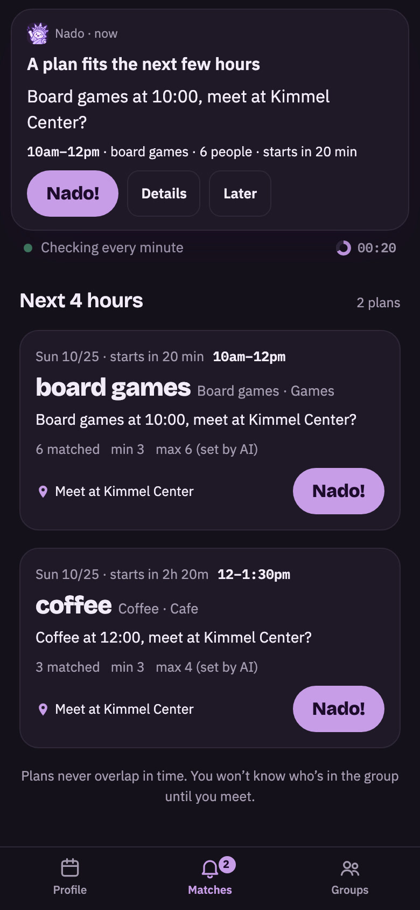
  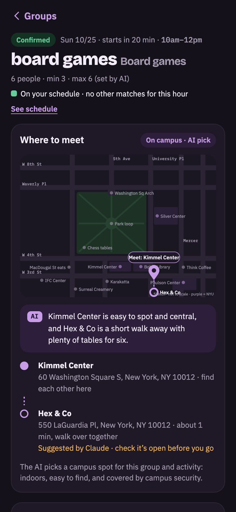
  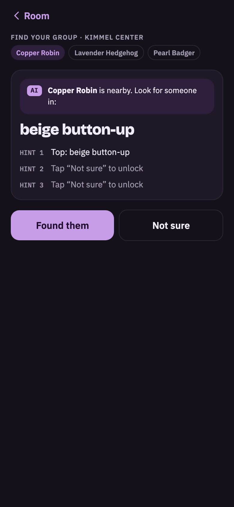
  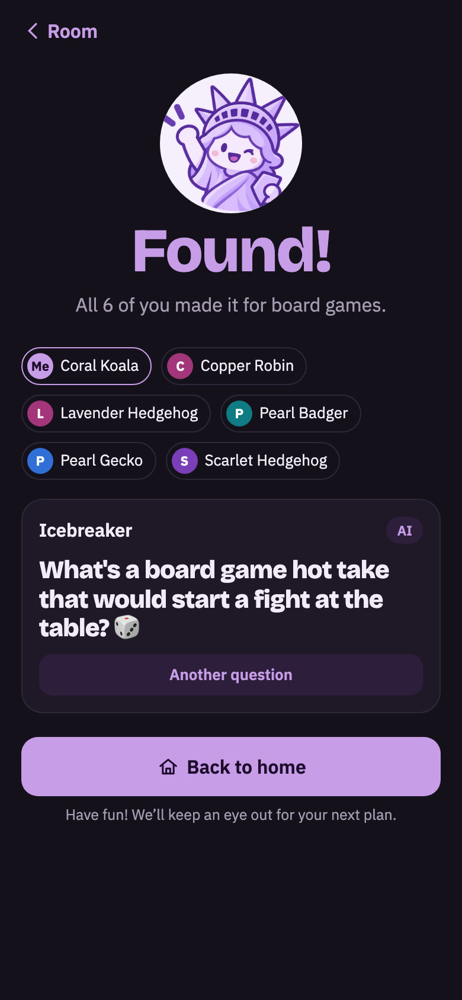
</p>

</div>

> ### For judges, in 30 seconds
>
> - **Problem:** you want to do something *now*, and nobody's free. Asking strangers feels awkward, so nobody asks. → [Why nado](#why-nado)
> - **What it does:** you pick up to 3 interests and share your class schedule. Every minute, nado finds other students who want the same thing and are free in the **next four hours**, then invites everyone at once. → [How it works](#how-it-works)
> - **Not Meetup:** nobody hosts, nobody browses, and a plan only exists once enough people already fit it. → [How it's different](#how-its-different)
> - **Claude:** reads your Albert screenshot, understands any interest you type, picks a campus meeting spot, writes the invite, and asks the first question. **Code, not Claude, decides who meets whom.** → [How we use Claude](#how-we-use-claude)
> - **Try it:** sign in with any `@nyu.edu` address. It's a demo, so any 6-digit code works. → [Try the demo](#try-the-demo)

<details>
<summary><b>Contents</b></summary>

1. [Why nado](#why-nado)
2. [How it's different](#how-its-different)
3. [How it works](#how-it-works) (for students)
4. [Under the hood](#under-the-hood) (matching, plan life cycle, rules)
5. [How we use Claude](#how-we-use-claude)
6. [Where Claude could go wrong](#where-claude-could-go-wrong)
7. [Data model](#data-model) (what's in the database)
8. [Try the demo](#try-the-demo) (what's real, what's simulated)
9. [Run it locally](#run-it-locally)
10. [Project structure](#project-structure)
11. [Known limits](#known-limits)

</details>

### Words we use

| Word | Meaning |
|---|---|
| **Plan** | An invitation nado opens for you: an activity, a time in the next four hours, and a meeting spot. |
| **Nado!** | Your "me too." Tapping it puts the plan in your **Groups** tab. |
| **Confirm** | The second tap, before the deadline. When everyone confirms (or enough people have by the deadline), the plan becomes a **room**. |
| **Room** | The confirmed meetup: where to meet, who's coming (by nickname), quick replies, and the find-each-other game. |
| **Sample students** | 800 generated NYU students, so there's someone to match with during the demo. See [what's simulated](#try-the-demo). |

---

## Why nado

We're four Korean exchange students, and we kept living the same moment:

> **"I want to do something right now, but there's no one to do it with."**

- 🏀 One of us had a free hour and badly wanted to play basketball. Nobody was free.
- 🎭 One of us went to a musical **alone**, because none of us cared about musicals.
- 🇰🇷 Slowly, we only hung out with other Koreans, because it was easy.

So why not just ask strangers? In practice, nobody does:

- **Nowhere to ask.** Thousands of students are around you, but there's no place to ask the ones who'd say yes.
- **The profile trap.** With strangers, you look at the profile first: face, looks, nationality. That's how bubbles form.
- **The host burden.** Whoever speaks first becomes the organizer: the place, the waiting, the small talk.

> **The insight:** few people ask, but far more would say *"me too"* if someone did. They just never see the question.

Back home, this moment has a one-word answer. A friend says *"I'm craving boba,"* and you say **"나도!"** (*nado*): "me too!" No planning, no hosting, no asking first. Abroad, there was nobody around to say it. So we built the thing that asks for you, and lets you just say *nado*.

### Right now, not someday

> *"Getting kind of hungry... anyone up for pizza?"*

That thought lasts about ten minutes. So spontaneity is the core of nado, not a feature:

- **The next four hours only.** No calendars, no "next Saturday?"
- **Built around the end of class.** A plan can start the minute your class lets out: *"Right after MATH-UA 121."*
- **Always fresh.** Matching runs every minute, on the minute.
- **One hour, two taps.** *Nado!*, then *Confirm*. You're giving up your next free hour, not your weekend. That makes "me too" easy, even to strangers.

## How it's different

| | ✨ **nado** | Meetup · Pie | Timeleft · 222 | Fizz · Sidechat |
|---|---|---|---|---|
| **What it is** | **Plans for your next free hour** | Event listings | Dinners and outings with matched strangers | Anonymous campus feeds |
| **Starts from** | **What you want to do** | An event someone hosts | A personality quiz | Posts |
| **Who sets it up?** | **No one.** nado opens the plan; you can't even create one. | An organizer (Pie also pays local hosts) | The service picks the group and the venue | Whoever posts |
| **Do you browse?** | **No.** A plan that fits your next free hour, or nothing. | Yes, a list of events | No. You book a date (Timeleft) or wait for an invite (222) | Yes, a feed |
| **When** | **Within the next 4 hours** | Scheduled ahead | Set dates the service runs | Anytime (online) |
| **Where** | **Your campus, minutes from class** | Around the city (Meetup also online) | Restaurants and venues in the city | Online |
| **Too few people?** | **Never opens.** A plan exists only once enough people fit it. | Up to the organizer | The event can be cancelled | Not an events app |

<sub>Based on each service's public descriptions, October 2026.</sub>

**Others start with a host, a quiz, or a post. We start with what you want to do and when you're free.** You choose *boba* and meet the people behind the nicknames when you get there.

## How it works

<p align="center">
  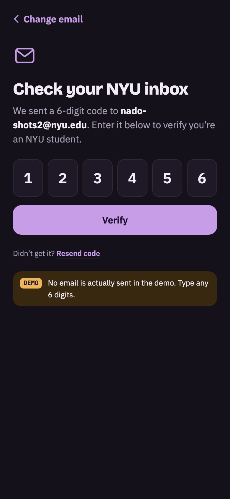
  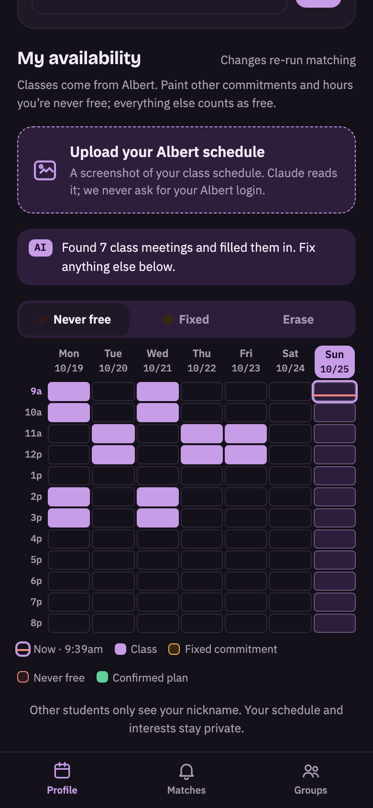
  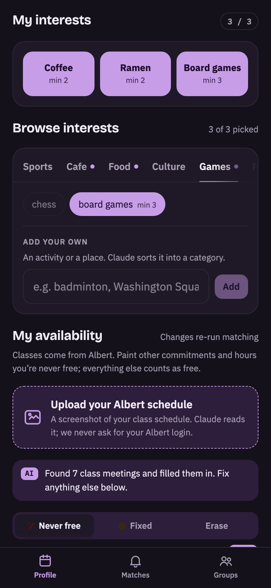
  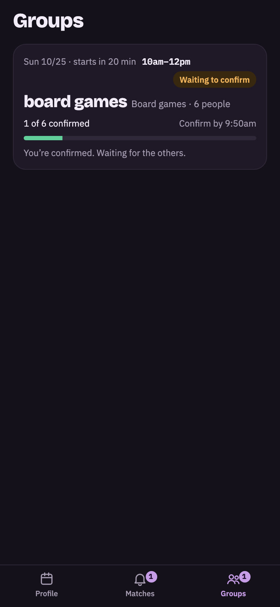
</p>

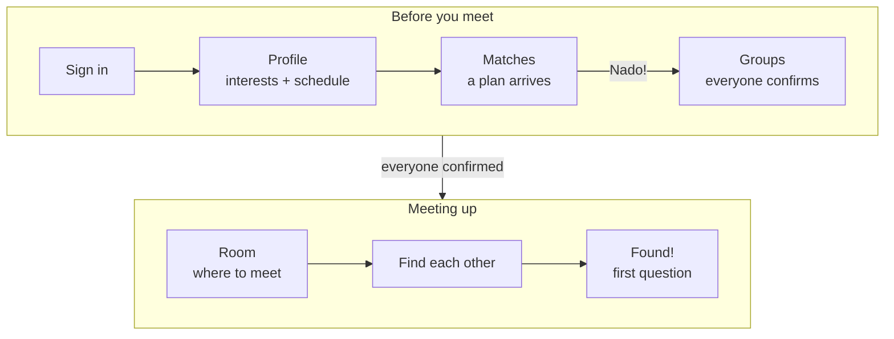

1. **Sign in** with your school email. (The idea works at any school; this build is set up for NYU: Albert schedules, NYU buildings, the Washington Square map.) You become a random nickname like **Coral Owl**. No photo, no bio.
2. **Set up once** on the Profile tab:
   - **Up to 3 interests.** Pick from categories (Sports, Cafe, Food, Culture, Games, Place, Other) or type your own, like *badminton* or *Washington Square Park*. For each, set the **smallest group you'd enjoy**.
   - **Your schedule.** Upload a screenshot of your Albert schedule and **Claude fills in your classes**. Paint anything else as *Fixed* (job, club) or *Never free*. Everything else, 9 AM to 9 PM, counts as free.
3. **Get a plan.** On Matches, a countdown shows the next check. When a plan fits, a banner arrives: ***Board games at 9:00, meet at Kimmel Center?*** Tap **Nado!**
4. **Confirm** in Groups before the deadline (10 minutes before it starts). When everyone confirms (or enough people have by the deadline), you drop into the **room**, and that hour is blocked on your schedule.
5. **Meet.** First at a public NYU building (Claude is told to pick one), then a short walk to the venue, with **Claude's one-line reason** for the spot.
6. **Find each other.** Tap **Share your outfit**. Hints about each member unlock one at a time. Still lost? **"I give up"** makes your screen glow.
7. **Found!** Claude asks the first question, about the activity you share. Then **Back to home**.

If someone taps **"I can't make it"** and the group falls below its minimum, the room dissolves and everyone else goes back into matching. The person who left isn't invited to that hour again.

## Under the hood

### Every minute: one matching run

A database timer (Supabase **pg_cron**) calls `GET /api/match` at :00 every minute. Open phones also call it on the minute, but `claim_match_minute()` lets only the first call in each minute through, so nobody is matched twice.

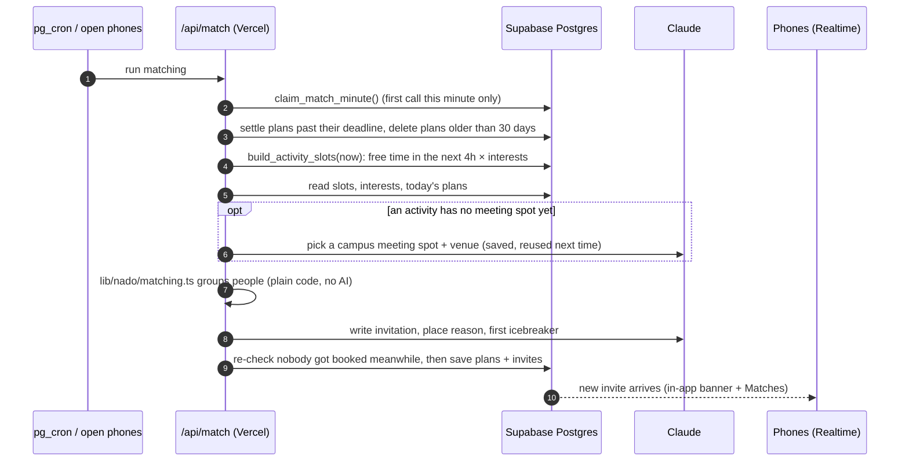

### Matching rules

These are all in code ([`lib/nado/matching.ts`](lib/nado/matching.ts), [`lib/server/match.ts`](lib/server/match.ts)), so the same input always gives the same groups. The numbers are today's values (subject to change); each one is a single constant in code.

| Rule | Value |
|---|---|
| Hours | Plans run between 9 AM and 9 PM, New York time, so the last one starts at 8 PM |
| How far ahead | Plans start within the next **4 hours**, at least **20 minutes** from now |
| Start time | The moment someone's free time begins (like a class ending), or on the hour / half hour |
| Length | **60 to 120 minutes**, ending before anyone's next busy block |
| Group size | Respects **each person's own minimum** and the activity's maximum |
| Which plan first | Bigger groups first, then earlier times |
| Limits per student | Up to **3 interests**, up to **3 open invitations**, one plan per activity per day, never two plans at the same time |
| Confirm deadline | **10 minutes** before the start |
| After "I can't make it" | That hour stays off-limits for you today |
| Old plans | Shown under **Past month** in Groups, deleted after **30 days** |

### Plan life cycle

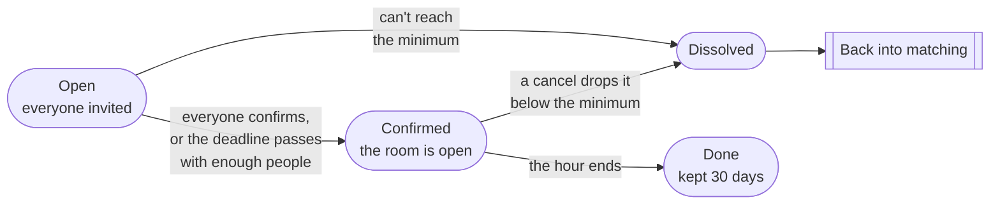

Each member moves through **invited → joined** (tapped *Nado!*) **→ confirmed**, or ends as **cancelled** ("I can't make it") or **declined** (no answer by the deadline). The rule is a small pure function, [`settle()` in `lib/match/rules.ts`](lib/match/rules.ts), with tests.

## How we use Claude

**Our rule: Claude does what only a language model can do. Code does what has to be exact.**

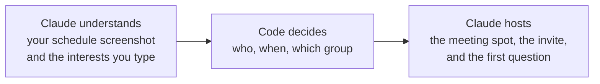

| # | When | What Claude does | Model | Limits and checks | If Claude fails |
|---|---|---|---|---|---|
| 1 | You upload an Albert screenshot | Reads every class meeting: course, day, start, end | Sonnet (vision) | Strict type and time checks, max 60 classes | You paint the hours yourself |
| 2 | You type your own interest | Category, the **largest group of strangers** it works for, a default minimum, and why. Drops "who can join" conditions (*"boba, Koreans only"* → **Boba**) | Sonnet | Size clamped to 2–12; reason ≤ 140 chars | Saved as *Other*, up to 4 people |
| 3 | An activity gets its first plan | Picks a **public NYU building** to meet and a real venue nearby, and says when it isn't sure the venue exists | Sonnet | Saved and reused for that activity; off-campus venues are labeled *"Suggested by Claude · check it's open before you go"* | A default campus spot, and Claude is asked again next time |
| 4 | Every new plan | Writes the invitation, the reason for the spot, and the first icebreaker | Sonnet | ≤ 60 / 160 / 90 characters | Plain templates |
| 5 | You tap *Another question* | A new icebreaker about the shared activity | Haiku | Confirmed members only; ≤ 90 chars | A built-in question list |

- **We never send who you are.** No names, emails, or IDs: only activities, times, and places. A schedule screenshot can show your name, so Claude is told to return only courses, days, and times, and that's all we keep.
- **Every prompt is in one file:** [`lib/nado/prompts.ts`](lib/nado/prompts.ts). The calls are in [`lib/nado/features.ts`](lib/nado/features.ts) (1, 2, 5) and [`lib/nado/plan.ts`](lib/nado/plan.ts) (3, 4).
- **Cost stays small.** A matching run calls Claude only when a real student has a plan to open: at most one call for new places and one call per 15 new plans for the text.
- **Before Claude sees a typed interest,** our own filter ([`lib/interest-text.ts`](lib/interest-text.ts)) rejects non-English text, offensive words, links, and keyboard mashing, with a friendly message.

How we tell Claude to handle bias, word for word (from `interestSystem` in `prompts.ts`):

```text
If the text includes a condition about who can join based on nationality, race, ethnicity, religion,
gender, age, sexuality or looks ("boba, Koreans only"), leave the condition out of the label.
Skill level ("beginners") and language practice are fine to keep.
```

## Where Claude could go wrong

| Where it can fail | What happens to the student | What we built |
|---|---|---|
| **Misreads your schedule** | Matched during a class | You see the result on the grid and fix it. Malformed answers are dropped. |
| **Bad group size** for a new interest | A 10-person "coffee" | Clamped to 2–12, and **you set your own minimum**. |
| **Closed or wrong venue** | Walk to a dead end | Off-campus venues say *"check it's open before you go."* **You meet at an NYU building first.** |
| **Lets bias through** | Rebuilds the bubble | **No nationality, race, or gender field exists.** Conditions are dropped from typed interests. |
| **Makes up plan details** | Wrong time or group | Code decides who and when. Claude picks the place and writes the words, and off-campus places are labeled. |
| **Too much text** | Cards fill the screen | Character limits in the prompt, then trimmed at a word. |
| **Wrong JSON shape, slow, or down** | No plan appears | Answers are shape-checked, and every call has a non-AI fallback. |

## Data model

The database is Supabase Postgres. The schema is [`supabase/schema.sql`](supabase/schema.sql), and the DB functions are in [`supabase/migrations/`](supabase/migrations).

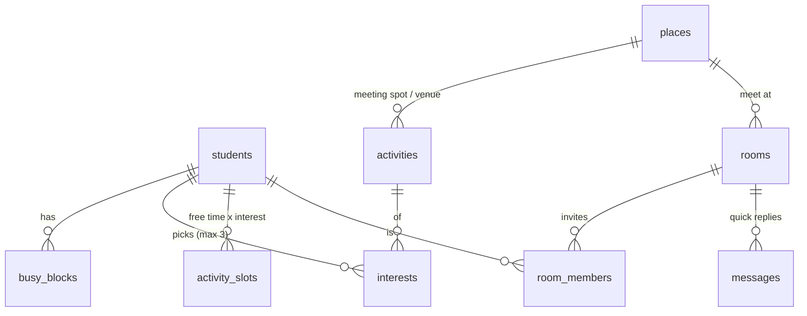

| Table | What's in it | Rows on Oct 25 |
|---|---|---|
| `students` | Nickname, NYU email (null for samples), `is_sample` | 805 (800 sample + 5 real) |
| `busy_blocks` | Weekly busy hours: `class` (Albert), `fixed`, `never` | ~10,400 |
| `interests` | Student × activity, with that student's minimum group size | ~2,100 |
| `activities` | 16 presets, 3 sample *Place* interests, and ones students added. Category, max size, and Claude's reason | 21 |
| `places` | Meeting spots and venues Claude picked (campus or not, address, nearest streets) | 14 |
| `activity_slots` | **Rebuilt every minute:** each student's free time in the next 4 hours × their interests | ~2,000 |
| `rooms` | Plans: activity, start/end, confirm deadline, status, place, Claude's invitation, reason, icebreaker | changes live |
| `room_members` | Who's invited, and their status and outfit hints | changes live |
| `messages` | Quick replies in a room ("I'm here", "5 min late") | changes live |
| `app_clock` | The shared demo clock (one row; empty = real time) | 1 |
| `match_runs` | Which minutes already ran matching | rolling, 1 day |

**DB functions:** `app_now()` (now, following the demo clock) · `build_activity_slots()` (free time is computed in the database, because the API returns at most 1,000 rows and `busy_blocks` has ~10k) · `claim_match_minute()` (once per minute) · `start_match_timer()` / `stop_match_timer()` (pg_cron, SQL Editor only).

## Try the demo

**The campus is simulated. You are real.**

A matching app is only as good as the people on it, so we generated a campus: **800 virtual NYU students** ([`scripts/generate-students.ts`](scripts/generate-students.ts)). Each has a realistic class schedule (75-minute MW/TR blocks, recitations, evening labs), jobs and clubs, 2–3 interests tilted by major, and their own minimum group size. So every hour of the week looks different, and the same command always generates the same campus.

1. Scan the QR code (or open **[nado-pied.vercel.app](https://nado-pied.vercel.app)**) on your phone and sign in with any `@nyu.edu` address. Any 6-digit code works. You join the 800 sample students as a real one.
2. Pick up to 3 interests and upload a schedule screenshot (or paint your hours).
3. Within a minute, if enough students are free and like the same thing, a plan appears. Tap **Nado!**, then confirm.
4. Sample students confirm on their own, the room opens, and you can play the find game through to **Found!**

To keep the sample students from using each other up, the demo only opens a plan when it includes at least one real student, and those plans go first.

| Real | Simulated |
|---|---|
| You, on your own phone | The other 800 students (generated, `is_sample = true` in the database) |
| Claude: reading the schedule, understanding interests, picking the spot, writing the invite and icebreakers | Sample students confirming, and their outfits in the find game |
| The matching code over all 800+ students, every minute | Login codes: no email is sent, any 6 digits work |
| Real-time updates between phones | **Hidden demo clock:** tap the clock on *Right now* 5 times to jump to any date and time (shared by every phone), so "right after class" works at any hour |

## Run it locally

```bash
git clone https://github.com/dasol0312/nado.git
cd nado
npm install
cp .env.example .env.local   # fill in the values below; never commit this file
npm run dev                  # http://localhost:3000
```

| Variable | Needed? | What it's for |
|---|---|---|
| `NEXT_PUBLIC_SUPABASE_URL`, `NEXT_PUBLIC_SUPABASE_ANON_KEY` | Yes | Your Supabase project |
| `ANTHROPIC_API_KEY` | Yes | Claude (server only; never sent to the browser) |
| `ANTHROPIC_WORKSPACE_ID` | Only if your key isn't tied to a workspace | |
| `NADO_SESSION_SECRET` | Yes in production | Signs the login cookie (any long random string) |
| `CRON_SECRET` | Recommended | The every-minute timer sends it to `GET /api/match` |
| `NADO_EMAIL_OTP` | No | `1` emails real 6-digit codes through Supabase Auth |
| `NADO_DEMO` | No | `0` turns off the demo routes (hidden clock, sample confirmations) |

**Database** (on a new, empty Supabase project), in this order in the SQL Editor:

1. `supabase/schema.sql` (⚠️ drops and recreates every table, so never run it on the team project)
2. `supabase/migrations/`: `20261024_activity_slots_week_start.sql`, `20261025_match_helpers.sql`, `20261025_match_timer.sql`, `20261025_match_every_minute.sql`, `20261025_place_category.sql`, `20261025_remove_demo_reset.sql`
3. `npm run seed:students` (16 preset activities and 800 sample students)
4. After deploying: `select start_match_timer('https://<your-app>/api/match', '<CRON_SECRET>');`

**Checks** (no API key or database needed):

```bash
npm run typecheck && npm run lint
npx tsx lib/nado/matching.test.ts   # grouping, deterministic results, class-end starts, sizes
npx tsx lib/match/rules.test.ts     # plan life cycle, leaving an hour
npx tsx lib/plan-lists.test.ts      # what shows in Matches and Groups
npx tsx lib/validate.test.ts        # bad input and malformed Claude answers
```

## Project structure

```
app/
  (tabs)/             Profile · Matches · Groups (share the bottom tab bar)
  login/              NYU email + 6-digit code
  rooms/[roomId]/     The room, and /find (outfit hints, glow, Found!)
  api/
    match/            The matching run (timer + phones)
    activities/       Add your own interest (Claude #2)
    schedule/read/    Albert screenshot (Claude #1)
    profile/          Save interests and busy hours
    rooms/[roomId]/   join (Nado!) · confirm · cancel · reply · outfit · icebreaker (Claude #5)
    auth/             start · verify · signout
    demo/             Hidden clock, sample students confirming
components/           One folder per screen (shell, auth, schedule, interests, matches, groups, room, find)
lib/
  nado/               Matching (no AI) · prompts · every Claude call and its fallback (#1–#5)
  server/             Matching run, plan life cycle, sessions, API helpers
  match/rules.ts      settle(): open or dissolve a plan
  time.ts             New York campus time, on any device
supabase/             schema.sql, migrations (DB functions, timer)
scripts/              800 sample students
docs/                 DEVELOPMENT.md (API details), screenshots
```

API details, request bodies, and error codes: [`docs/DEVELOPMENT.md`](docs/DEVELOPMENT.md).

## Building it

- **"Isn't this just Meetup?"** Our first version showed a list of rooms, and mentors said it looked like Meetup or 222. The difference was real but invisible, so we removed browsing entirely: you get a plan for your next free hour, or nothing.
- **LLMs are bad at clocks.** We first asked Claude to compute overlapping free time. It was *mostly* right, which isn't good enough when "mostly" sends someone to boba during their lecture. All time math moved into code; Claude kept the language.
- **A matching app with no users matches nobody.** So we generated a campus. Then the sample students matched each other first and left no one for the real judge, so now a plan only opens when it includes a real student.
- **Our first hackathon, and a new stack.** None of us had shipped with Supabase or Vercel before.

## Known limits

We'd rather say these plainly:

- **Demo login.** Any 6-digit code works. Real email codes are built (`NADO_EMAIL_OTP=1`) but need an email provider set up in Supabase.
- **Open database rules.** Row-level security is open for the hackathon. Before real students join, the server needs its own key and the browser should only read its own rows.
- **No real push notifications yet.** The banner appears while the app is open.
- **One campus.** Places, streets, and the map are built around Washington Square.

**Next:** reporting after each meetup, limited to no-shows, harassment, and inappropriate behavior (so it protects people without becoming a rating system) · real push notifications · locked-down database access · more campuses, one at a time.

## Team

Four Korean exchange students who kept wishing someone nearby would say *"나도!"*

| Name | Role | What they built |
|---|---|---|
| Kyeongseo Jang | _role_ | _what they built_ |
| Yeyoung Kwon | _role_ | _what they built_ |
| Dasol Yun | _role_ | _what they built_ |
| Yerin Eun | _role_ | _what they built_ |

Built at **Cal Hacks 13.0**, San Francisco · Powered by the **Claude API** and developed with **Claude Code**

---

<div align="center">

*Nobody has to ask first. nado opens the plan. You just say*

### **"나도!" — nado. Me too.**

</div>
