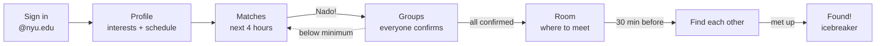
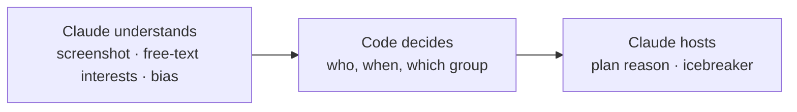
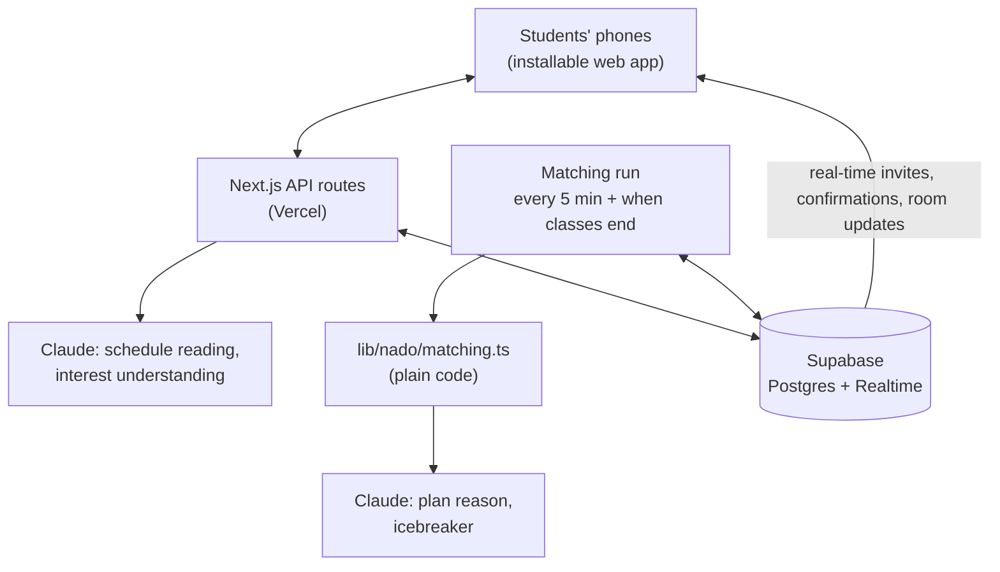

<div align="center">

# nado

> Every way to meet people starts with someone speaking up first.
> ### You don't have to be the first to speak up. nado does that for you.
> Tell it what you'd love to do and when you're in class. <br>
> When other students want the same thing in the **next four hours**, nado opens the plan and invites everyone.
>
> ## No host. No profiles. No empty events.
> You just say *"me too,"(nado)* and meet people you'd never have met.

**na·do** · */ˈnɑː.doʊ/* · **나도** means ***"me too"*** in Korean, and ***do*** means let's actually do it.

Built at **Cal Hacks 13.0** by four Korean exchange students.


**[▶ Demo video](#)** · **[Live app](#)** · **[Interactive prototype](https://claude.ai/artifact/VGToCEKiJ9WsL4UkSko2Ss)** · **[Devpost](#)**

<!-- Put a 10-second GIF here: Nado! tap → room → glowing screen → Found!
 -->

</div>

> **For judges, in 30 seconds**
> - **Problem:** you want to do something *now*, and nobody's free. → [Why nado](#why-nado)
> - **Spontaneous:** plans for **today, up to 4 hours ahead**, starting when your class ends. → [Right now](#right-now-not-someday)
> - **Not Meetup:** **nobody hosts, nobody browses**, and there are no empty events. → [Isn't this just Meetup?](#isnt-this-just-meetup)
> - **Claude:** reads your schedule, understands any interest, screens out bias, hosts the meetup. → [How we use Claude](#how-we-use-claude)
> - **Failure modes:** 8 ways Claude could fail a student, and our fix for each. → [Where Claude could go wrong](#where-claude-could-go-wrong)
> - **Connecting people:** success isn't time in the app. It's **strangers who actually met**. → [Connecting people, offline](#connecting-people-offline)

---

## Why nado

We're four Korean exchange students, and we kept living the same moment:

> **"I want to do something right now, but there's no one to do it with."**

It's not that we had no friends. It's that:

- 🏀 One of us had a free hour and badly wanted to play basketball. Nobody was free.
- 🎭 One of us went to a musical **alone**, because none of us cared about musicals.
- 🇰🇷 Slowly, we only hung out with other Koreans, because it was easy.

So why not just ask strangers? In practice, nobody does:

- **The silence.** You post *"anyone up for basketball?"* in the group chat. Nobody replies. Now it's embarrassing.
- **The profile trap.** With strangers, you look at the profile first: face, looks, nationality. You judge, often without noticing. That's how the Korean bubble forms.
- **The host burden.** Whoever speaks first becomes the organizer: the place, the waiting, the small talk.

> **The insight:** it's not that nobody wants to join. The people who would say *"me too"* never see the question.
> **Few people ask, but far more would say yes if someone did.**

Back home, this moment has a one-word answer. A friend says *"I'm craving boba,"* and you say:

<div align="center">

### **나도!** *(nado)* — "Me too!"

</div>

No planning, no hosting, no asking first. When friends text, it softens into **나두** (*nadu*): *"나두나두!"* And read as **나 + do**, it's *"I'll do it."*

Abroad, there was nobody around to say *nado*. So we built the thing that says it for you. This isn't only for exchange students: it's for anyone with a free hour and no one to share it with, and anyone who wants to get to know people **outside their friend circle**, without a profile in the way.

## Right Now, Not Someday

Most apps help you plan. nado is for the moment you didn't plan.

> *"Ugh, getting kind of hungry... anyone up for pizza?"*

That thought lasts about ten minutes. If finding people takes a day of back-and-forth, it's gone. So **spontaneity is the core of nado**, not a feature:

- **Today only, up to four hours ahead.** No calendars, no "next Saturday?" Every plan starts within the next four hours, some just minutes away.
- **Built around the end of class.** *"Right after MATH-UA 121"*: plans start when your class lets out, because that's when the free hour actually begins.
- **Always fresh.** nado re-checks every 5 minutes and whenever a class ends, so a plan can show up while you're walking out of the lecture hall.
- **One hour, one tap.** You're not giving up your weekend, just your next free hour. That's what makes saying *"나도!"* easy, even to strangers.

A plan made weeks ahead needs commitment. A plan for *right now* only needs a yes.

## Why Existing Apps Don't Fix It

| | Timeleft · Pie · 222 | Fizz · Sidechat | **nado** |
|---|---|---|---|
| **Starts from** | Who you are (personality quiz) | What people post | **What you want to do** |
| **When** | A date the service picks | Whenever someone posts | **The next 4 hours** |
| **Where** | Venues around the city | Online | **Your campus, minutes from class** |
| **Who's in?** | Matched to your personality | Usernames | **Nicknames, until you meet** |

**They start with people. We start with the activity.** You choose *boba at 3:15* and find out who's coming when you get there. Nobody is judged by a profile, and nobody is rejected, because a plan only exists once enough people already fit it.

**And none of them is built around one campus.** "See you after class" only works if the app knows your class ends at 3:15, that Kimmel is a three-minute walk, and that you have exactly one free hour. nado is built around NYU's schedule and buildings.

### Isn't this just Meetup?

Both end with people doing something together. Everything before that is the opposite.

| | Meetup | nado |
|---|---|---|
| **Someone has to host** | Yes. An organizer creates the event, picks the place, and waits for RSVPs. | **No one.** nado opens the plan. You can't even create one. |
| **You browse** | A list of events, and decide from the title, host, and who's going. | **Nothing to browse.** You get a plan that fits your next free hour, or nothing. |
| **Empty events** | Common. An event can sit with zero RSVPs, and the host feels it. | **Impossible.** A plan exists only once enough people already fit it. |
| **When** | Days or weeks ahead, on a calendar. | **The next four hours**, built around when your class ends. |
| **Who you see first** | The host's profile and the attendee list. | **Nicknames**, until you're standing in the same lobby. |

**Meetup helps people who are ready to ask. nado is for everyone else**: the student who would have said *"me too"* but was never going to post *"anyone up for basketball?"*

## How It Works



1. **Sign in** with an NYU email. You become a random nickname like **Coral Owl**. No photo, no bio.
2. **Set up once.** Pick interests and the smallest group you'd enjoy for each. Upload a screenshot of your Albert schedule and **Claude reads your classes**. Paint anything else as *Fixed* or *Never free*.
3. **Get matched.** Every 5 minutes, and whenever a class ends, nado checks the next four hours: ***Boba · 3:15–4:15 PM · Right after MATH-UA 121 · 4 matched · meet at Kimmel.*** A push arrives. Tap **Nado!**
4. **Confirm.** When everyone confirms, you drop straight into the room and the hour goes on your schedule, so you're never double-booked.
5. **Meet.** Always at a public NYU lobby first, then a short walk to the venue, with **Claude's one-line reason** for the plan.
6. **Find each other.** You describe your outfit; hints about your group unlock one at a time. Still lost? Tap **"I give up"** and your screen **glows** *"I'm here!"*
7. **Found!** **Claude asks the first question**, about the activity you share, so nobody has to break the silence.

If someone drops out and the group falls below its minimum, the room dissolves and that hour is matched again.

## How We Use Claude

**Our rule: Claude does what only a language model can do. Code does what has to be exact.**



| | Where | What Claude does | Without Claude |
|---|---|---|---|
| **1** | **Reads your schedule** (vision) | Albert screenshot → classes (course, day, start, end) | Typing every class by hand. Most people quit at setup. |
| **2** | **Understands any interest** | *"Badminton"* → category, **realistic group size for strangers**, venue, and why | A fixed dropdown. Anything else can't be matched. |
| **3** | **Cleans and screens** | *"bubble tea"* → *"boba"* · *"boba, Koreans only"* → *"boba"* · dating requests skipped | Same wish, split apart. Bias gets in. |
| **4** | **Explains the plan** | *"Kimmel is easy to find between classes; Surreal Creamery is 4 min away."* | A map pin with no reason to trust it. |
| **5** | **Breaks the ice** | One light question about the shared activity | Someone has to speak first. |

**What Claude does not do**

- **Decide who meets whom.** That's plain, tested code in [`lib/nado/matching.ts`](lib/nado/matching.ts). Same input, same groups, so we can always explain *why this group*.
- **See who you are.** Claude sees activities, times, and places. Never names, emails, or IDs. (From a schedule screenshot, we keep only course codes and times.)
- **Block anything.** Every call has a fallback. A failed call never stops a plan.

**See it in the code.** Every prompt lives in [`lib/nado/prompts.ts`](lib/nado/prompts.ts). Here's how we tell Claude to handle bias, word for word:

```text
If the name includes a condition about who can join based on nationality, race, ethnicity,
religion, gender, age, sexuality, or looks (for example "boba, Koreans only" or "basketball,
guys only"), remove the condition, keep the activity, and put the removed text in
"removed_condition". Skill level ("beginners welcome") and language practice
("Korean conversation practice") are fine and are not conditions to remove.
```

And the tests check it: [`lib/nado/matching.test.ts`](lib/nado/matching.test.ts) covers *"boba, Koreans only" → boba*, *"date night" → skipped*, eight people wanting boba at once, and one student wanting two things at the same hour.

## Where Claude Could Go Wrong

Using AI thoughtfully means knowing how it fails the person on the other end.

| Where it can fail | What happens to the student | What we built |
|---|---|---|
| **Misreads your schedule** | Matched during a class | You see and fix what it read. Strict format checks. |
| **Bad group size** for a new interest | 10-person "coffee" | Clamped to 2–12. **You set your own minimum.** |
| **Closed or wrong venue** | Walk to a dead end | Marked *"check it's open."* **You always meet at an NYU lobby first.** |
| **Lets bias through** | Rebuilds the bubble | **No nationality, race, or gender field exists.** Conditions are stripped, and you're told. |
| **Used for dating** or unsafe plans | Others feel targeted | Screened out. NYU-only sign-in and public places back it up. |
| **Makes up plan details** | Wrong place or time | Code builds the plan from verified places. Claude only explains it. |
| **Awkward icebreaker** | Uncomfortable first minute | Activity-only questions. One tap for another. |
| **Slow or down** | No plan appears | A non-AI fallback for every call. |

**Safety beyond AI:** NYU email only · nicknames, no photos · public meeting places · nothing happens until you tap *Nado!* and confirm · no free-text chat to moderate · the API key never reaches the browser.

## Connecting People, Offline

**nado gets you to know people outside your friend circle.** Your friends are great, but they're the same few people, with the same schedules and the same interests. nado connects you with the ones you'd never have met: different countries, different majors, different friend groups, the same love of boba at 3:15. Most social apps measure time spent in the app. nado measures **people who actually met**.

- **It ends offline.** No feed, no swiping, no chat. A few seconds in the app, an hour with people.
- **No profiles until you meet.** People meet you, not a photo.
- **The awkward first minute is designed.** Finding each other is a small game, your screen glows when you're lost, and Claude asks the first question.
- **No one gets rejected.** A plan appears only when enough people already fit it.
- **It breaks bubbles by default.** You don't pick who's in, so you meet whoever loves boba at 3:15. For four Korean students, that was the point.

## Architecture



| Layer | Technology |
|---|---|
| Frontend and API | [Next.js](https://nextjs.org) (installable web app, no app store) |
| Database and real-time | [Supabase](https://supabase.com) (Postgres + Realtime) |
| AI | [Claude API](https://docs.claude.com) (vision, reasoning, short text) |
| Hosting | [Vercel](https://vercel.com) |
| Built with | [Claude Code](https://docs.claude.com/en/docs/claude-code) |

```
app/          Next.js pages and API routes
components/   Screens
lib/nado/     matching.ts (no AI) · prompts.ts · claude.ts (calls + fallbacks) · matching.test.ts
supabase/     Schema, seed data, migrations
```

## Run It Locally

```bash
git clone https://github.com/dasol0312/nado.git
cd nado
npm install
cp .env.example .env.local   # fill in the keys below; never commit this file
npm run dev
```

```
NEXT_PUBLIC_SUPABASE_URL=...
NEXT_PUBLIC_SUPABASE_ANON_KEY=...
ANTHROPIC_API_KEY=...
ANTHROPIC_WORKSPACE_ID=...   # only if your key isn't tied to a workspace
```

- **Database:** with your own empty Supabase project, run `supabase/schema.sql`, the two files in `supabase/migrations/`, then `npm run seed:students`. (On the team project, don't run schema.sql: it resets existing data.)
- **Tests:** `npx tsx lib/nado/matching.test.ts` (no API key needed)

## Demo: What's Real and What's Simulated

**The campus is simulated. The judge is real.**

A matching app is only as good as the people on it, so we built a campus: **800 virtual NYU students**, each with their own weekly class schedule (realistic Mon/Wed and Tue/Thu blocks, lunch rushes, evening labs), fixed commitments, interests, and the smallest group they'd enjoy for each. Nobody shares a schedule, so every hour of the week looks different.

When a judge signs in on their own phone, they join that campus as **student #801**:

1. They scan a QR code, sign in, pick *boba*, and upload a schedule.
2. nado runs matching across all 801 students and finds a plan *right after one of their classes*, with real sample students who are free and want boba too.
3. They tap **Nado!**, confirm, play the find game, give up, and their screen glows. **Found!** Claude asks the first question.

| Real | Simulated (and labeled in the UI) |
|---|---|
| The judge, on their own phone | The other 800 students: generated schedules, interests, and group sizes, marked as sample data |
| Claude reading the schedule, understanding interests, screening, writing the plan and icebreaker | Sample students' confirmations and outfits in the find game |
| The matching code, running over all 801 students | A presenter-only demo clock, so "right after class" works at any hour |
| Real-time updates between phones | Matching on a button press instead of every 5 minutes |

**Next:** real push notifications · Claude with live web search for venues open right now · private post-meetup feedback and blocking · more campuses, one at a time.

## Team

Four Korean exchange students who kept wishing someone nearby would say *"나도!"*

| Name | Role |
|---|---|
| _name_ | _role_ |
| _name_ | _role_ |
| _name_ | _role_ |
| _name_ | _role_ |

Built at **Cal Hacks 13.0**, San Francisco · Powered by the **Claude API** and developed with **Claude Code** · Planning guided by [calhacks-kit](https://github.com/georgeykalangi/calhacks-kit)

---

<div align="center">

*Nobody has to ask first. nado opens the plan. You just say*

### **"나도!" — nado. Me too.**

</div>
